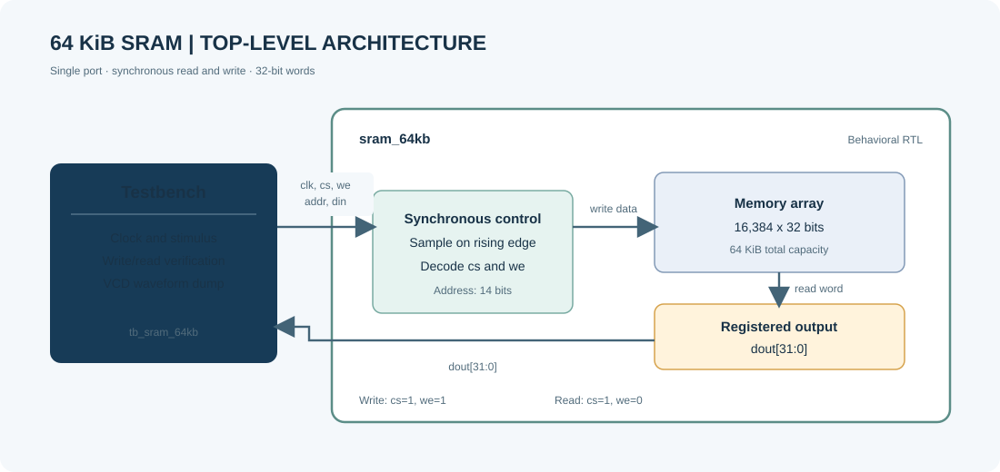
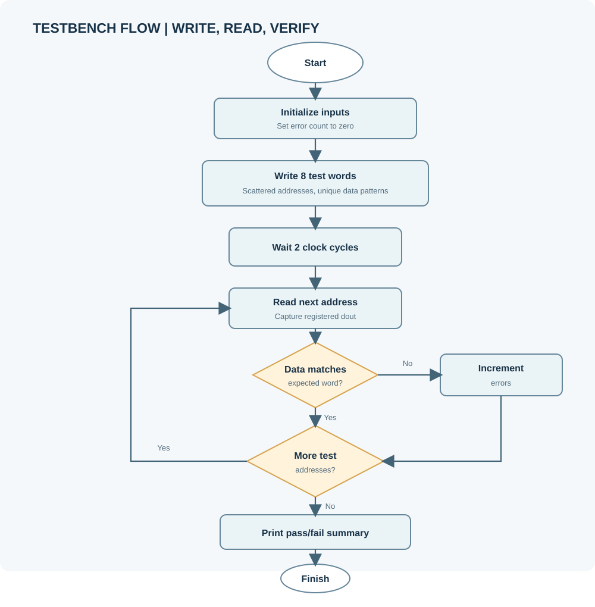
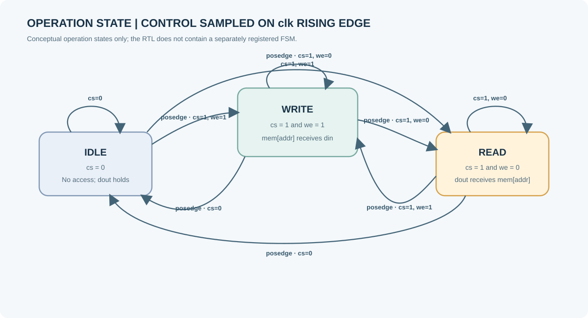
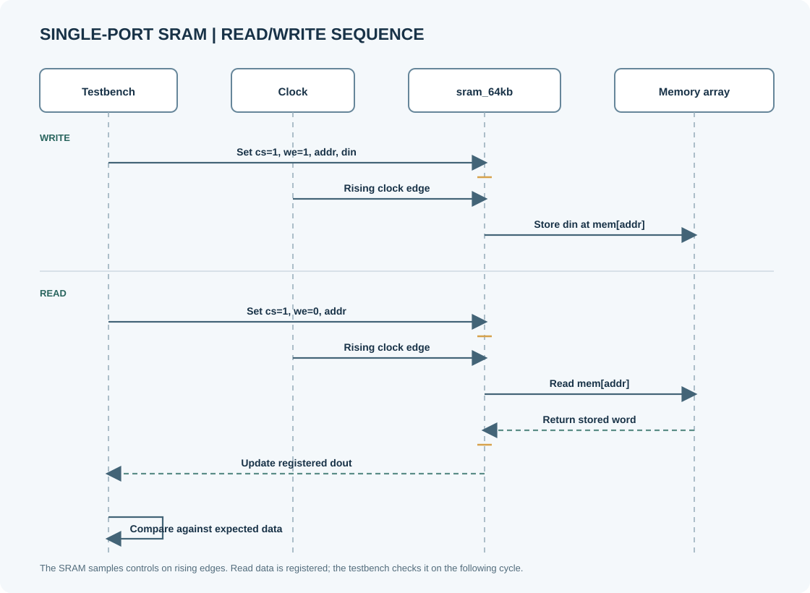

# 64 KB SRAM RTL Project

A single-port, synchronous SRAM model with a 32-bit data bus and 16,384 addressable words. The storage capacity is 524,288 bits (64 KiB). The project includes an HDL testbench and simulation flows for Icarus Verilog/GTKWave and AMD Vivado/XSim.

## Architecture

The diagrams describe the behavioral RTL. The SRAM is modeled as a flat array of 16,384 32-bit words; the control behavior is synchronous to the rising edge of `clk`.

### Top-Level Block Diagram



### Testbench Flow



### Operation State Machine

This is a conceptual operation-state view, not a separately registered FSM. `cs` and `we` select the operation independently at each rising edge.



### Read/Write Sequence



## Design Interface

| Signal | Direction | Description |
| --- | --- | --- |
| `clk` | Input | Clock; operations occur on its rising edge. |
| `cs` | Input | Active-high chip select. When low, the memory ignores the cycle and `dout` holds its value. |
| `we` | Input | Write enable. `1` writes `din`; `0` reads the addressed word into `dout`. |
| `addr[13:0]` | Input | Word address, from 0 through 16,383. |
| `din[31:0]` | Input | Data to write. |
| `dout[31:0]` | Output | Registered read data. |

There is no reset or initialization logic. Memory contents, and `dout` before the first read, are undefined in simulation. A read or write is performed only when `cs` is high at a rising clock edge.

## Project Files

- `SRAM_64KB.v` — SRAM RTL module (`sram_64kb`).
- `tb_sram_64kb.v` — Testbench; writes and reads eight locations, checks returned data, and dumps `sram_64kb.vcd`.
- `SRAM_64KB.xpr` — Vivado project.
- `run_vivado_sim.tcl` — Opens the project, selects the RTL and testbench tops, launches behavioral XSim, and saves the Vivado waveform configuration.
- `sram_64kb.gtkw` — GTKWave layout for the Icarus-generated VCD.
- `sram-dataflow.html` — Interactive browser walkthrough of SRAM data movement and the Vivado timing waveform.

Run commands from the project root so relative source and waveform paths resolve correctly.

## Icarus Verilog

Requirements: Icarus Verilog (`iverilog` and `vvp`). Compile and run from PowerShell:

```powershell
iverilog -g2012 -s tb_sram_64kb -o sram_64kb_sim.vvp SRAM_64KB.v tb_sram_64kb.v
if ($LASTEXITCODE -ne 0) { throw 'Icarus compilation failed.' }
vvp .\sram_64kb_sim.vvp
```

The testbench prints each write and read result. A successful run ends with:

```text
RESULT : ALL 8 LOCATIONS VERIFIED SUCCESSFULLY
```

The simulation writes `sram_64kb.vcd` in the project root. Open the saved GTKWave layout with:

```powershell
gtkwave .\sram_64kb.gtkw
```

The layout includes the clock, chip select, write enable, address, input data, output data, and sampled read data. To view the raw dump instead, run `gtkwave .\sram_64kb.vcd`.

## Vivado / XSim

Requirements: AMD Vivado with XSim. From PowerShell in the project root, launch the behavioral simulation and waveform view with:

```powershell
vivado -mode gui -source .\run_vivado_sim.tcl
```

If Vivado is not on `PATH`, use its installed `vivado.bat` path instead. For example, on the installation used for this project:

```powershell
& 'C:\AMDDesignTools\2026.1\Vivado\bin\vivado.bat' -mode gui -source .\run_vivado_sim.tcl
```

The script selects `sram_64kb` as the design top and `tb_sram_64kb` as the simulation top, runs behavioral simulation, adds signals to the wave window, and saves `sram_64kb.wcfg`. The native XSim waveform database is generated at:

```text
SRAM_64KB.sim/sim_1/behav/xsim/tb_sram_64kb_behav.wdb
```

The testbench finishes at 410 ns after verifying the eight test locations. The Vivado log and simulator transcript are useful for diagnosing compile or simulation errors (`vivado.log` and `SRAM_64KB.sim/sim_1/behav/xsim/simulate.log`).
